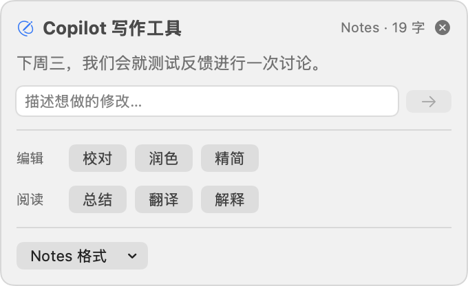
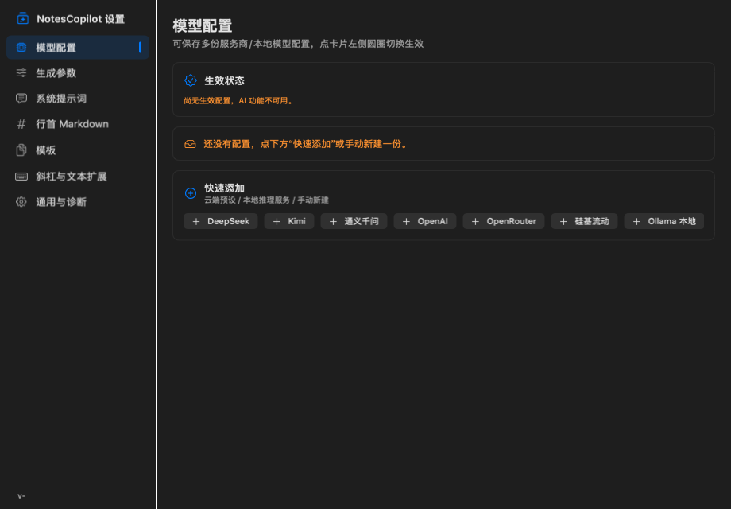

<div align="center">


# NotesCopilot

English · [简体中文](README.md)

Write in Apple Notes and work with selected text across your Mac.

[Download v2.10.1 for Apple silicon](https://github.com/m0nkee/notescopilot/releases/download/v2.10.1/NotesCopilot-2.10.1-arm64.dmg) · [Release notes and checksum](https://github.com/m0nkee/notescopilot/releases/tag/v2.10.1) · [User guide (Chinese)](docs/USAGE.md)

</div>

## Open Copilot Writing Tools from a text selection

NotesCopilot is a native macOS menu bar app. By default, the floating launcher appears when you select text in the body of an Apple Notes note. To use it in other apps, go to **Settings → Commands & Expansion → Selection Writing Tools** and set **Scope** to **All Apps**.

<picture>
  <source media="(prefers-color-scheme: dark)" srcset="docs/images/selection-launcher-dark.png">
  
</picture>

1. Select the text you want to work with. When the launcher appears, **click it or press `M` once** to open the tools menu.
2. Press `T` to translate. By default, NotesCopilot translates Simplified and Traditional Chinese text into English and other languages into Simplified Chinese. For mixed-language text, the main language determines the direction. To choose another target language, press `I`, enter an instruction such as “Translate into Japanese,” and press Return.
3. Compare the result with the original and copy the version you want. NotesCopilot sends your selected text to the configured model when you choose an action or submit a custom instruction.

| Where you select text | Available actions |
| --- | --- |
| Body of an Apple Notes note | Copy the result, replace the selection, append after it, or apply native formatting from **Notes Formatting** |
| Read-only text, such as web pages or chat replies | Review and copy the result. If a chat page redraws, a translation already in progress stays in the panel |
| Supported editable fields | Copy the result. Replace or append when NotesCopilot can verify the original window, field contents, and selection |
| Apps that support text services | Open **Services → Process Selected Text with NotesCopilot** to review the result. If the launcher has identified the same editable selection, you can also append or replace it |

Press `M` to open the tools and `T` to translate. When the translation appears, press `C` to copy it or `O` to compare it with the original. If the selection is still writable, press `A` to append or `R` to replace. While typing an instruction, letter keys enter text. Press `Esc` to return to the tools, then press it again to close them.

`M` works when the launcher is visible and the source app is in the foreground. Cross-app support depends on whether the host exposes its text selection through macOS Accessibility. Secure text fields are skipped.



The project has tested replacing and appending text in Chrome’s address bar, selecting text in the Codex chat composer, and translating message text in OpenMausBot and WorkBuddy. [Selection behavior and test coverage (Chinese)](docs/WRITING-TOOLS.md)

## Install and configure

Choose **Follow System**, **简体中文**, or **English** under **Settings → General & Diagnostics → Interface Language**. The app interface switches immediately and remembers your choice. macOS permission prompts and the Services menu use the language selected in macOS.

1. Download the DMG, drag `NotesCopilot.app` into Applications, and open it. The release requires **Apple silicon and macOS 13 or later**. The release page also provides `NotesCopilot-2.10.1-arm64.dmg.sha256`.
2. In Settings, choose a provider or local model, enter any required credentials, and click **Save Profiles**. NotesCopilot supports DeepSeek, Kimi, Qwen, OpenAI, OpenRouter, SiliconFlow, and custom OpenAI-compatible endpoints. It can discover local Ollama, LM Studio, llama.cpp, and vLLM endpoints.
3. Allow NotesCopilot in **System Settings → Privacy & Security → Accessibility**. Enable the corresponding permissions if you plan to write back to Notes or index your notes locally.

NotesCopilot opens Settings on first launch if it needs configuration. After setup, open the AI panel from the menu bar or with `⇧⌘Space`. If the menu bar icon is obscured, reopen the app to bring its main window back.

Check for updates from **Check for Updates…** in the menu bar or from **Settings → General & Diagnostics**. Select **Download** in the update prompt or the versioned download button in Settings. NotesCopilot verifies the SHA-256 checksum, saves the DMG in Downloads, and reveals it in Finder. You can cancel a download in progress. Automatic checks run daily by default and can be turned off in Settings.

The current DMG uses Apple Development signing. Apple notarization has yet to be completed, so Gatekeeper may say it cannot verify the developer. If macOS says it cannot check the app for malicious software, click **Done**, then go to **System Settings → Privacy & Security**, click **Open Anyway** in the Security section, and confirm.

## More features in Notes and the menu bar

- **AI panel** supports streaming chat, rendered Markdown and raw output views, code blocks, tables, checklists, and rich-text writeback. Configure temperature, maximum output length, and reasoning effort per model. For models such as `gpt-6.1-terra` that accept only the default temperature, requests omit `temperature`. The default reasoning effort omits `reasoning_effort`. The app restores the most recent chat after restart and keeps partial output when you stop generation. Switching note sources or model profiles starts a new chat. Continued chats include up to the last six turns.
- **Notes slash commands** appear when you type `/` in a note. Enter `/ai`, `/markdown`, `/templates`, or `/tools` to browse a category. Keep typing to filter, use the arrow keys to select a command, and press Return to run it.
- **Templates** come from the **Templates** folder in Apple Notes by default and refresh when notes change. You can also save local templates with date, selection, input prompt, and AI variables. When templates share a name, the Notes version takes precedence.
- **Note Library** provides local full-text search, recent searches, highlighted matches, and Markdown previews. **URL title links** turn a URL into a link labeled with its page title when you paste the URL in Notes and type a space.



## Permissions and data

| Permission or data | Use |
| --- | --- |
| Accessibility | Read selections, display the launcher, respond to selection shortcuts, and write back to a verified selection after confirmation. Keyboard navigation uses the same permission |
| Automation | Confirm the active note’s identity and create or edit notes using Apple Events |
| Full Disk Access | Read the local Apple Notes database for the library index and Notes templates |
| Models and credentials | API keys are stored locally in app preferences with your model profiles. Selection tools send only the instruction and selected text. The main chat panel can send note contents, recent chat history, or attachments based on the current context |
| Web page titles | Fetch the page to resolve its title, with shared local cookies or open browser tabs available as fallbacks |

The global launcher keeps a temporary copy of the selected text in memory. If the source selection becomes invalid, you can still work with the excerpt and copy the result. Clicking **Replace** or **Append** checks the write location again. View permission status and test your model connection in **General & Diagnostics**.

## Build and test from source

Build with the Xcode command-line tools. There are no third-party runtime dependencies.

```bash
git clone https://github.com/m0nkee/notescopilot.git
cd notescopilot
./build.sh
scripts/run-tests.sh
scripts/check-ui.sh
scripts/check-startup.sh
```

`build.sh` writes `build/NotesCopilot.app` by default. Set `NC_BUILD_OUTPUT` to build at a separate path and `NC_CODESIGN_IDENTITY` to choose a signing identity. The script prefers an available `NotesCopilot Dev` certificate or the sole available Apple Development identity. For development, set the identity to `-` for ad hoc signing. macOS may ask for permissions again after rebuilding.

In a graphical session with Accessibility permission, you can verify cross-process text fields and system Services. The packaging script verifies the architecture, code signature, and disk image.

```bash
NC_TEST_INPUT_FIELDS=1 NC_TEST_SYSTEM_SERVICE=1 scripts/check-startup.sh
NC_BUILD_OUTPUT=build/release/NotesCopilot.app ./build.sh
scripts/package-dmg.sh
```

Source code is in `src/`, regression tests are in `tests/`, and native control probes and UI rendering tools are in `tools/`. [Architecture (Chinese)](docs/ARCHITECTURE.md) · [Validation (Chinese)](docs/VALIDATION.md) · [Changelog (Chinese)](CHANGELOG.md)

[MIT License](LICENSE)
