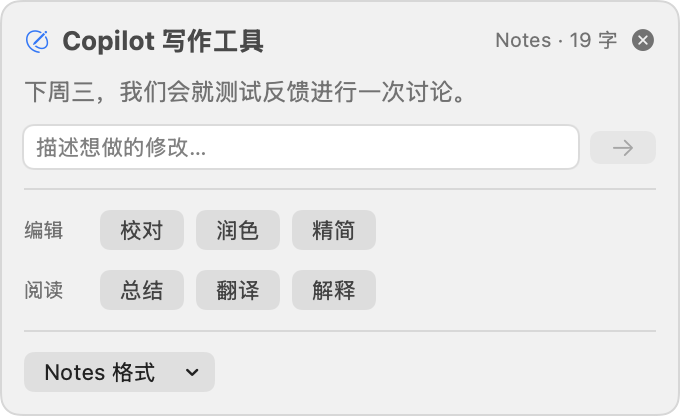
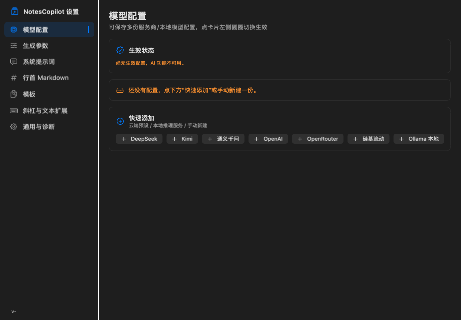

<div align="center">


# NotesCopilot

在 Apple Notes 里写作，也能在 Mac 上直接处理选中的文字。

[下载 v2.8.1 · Apple Silicon](https://github.com/m0nkee/notescopilot/releases/download/v2.8.1/NotesCopilot-2.8.1-arm64.dmg) · [发布说明与校验文件](https://github.com/m0nkee/notescopilot/releases/tag/v2.8.1) · [使用手册](docs/USAGE.md)

</div>

## 选中文字，打开写作工具

NotesCopilot 是一个原生 macOS 菜单栏应用。默认在 **Notes 正文**显示选区浮钮。要在其他应用使用，打开「设置 → 斜杠与文本扩展 → 选区写作工具」，将「应用范围」切到 **全局**。

<picture>
  <source media="(prefers-color-scheme: dark)" srcset="docs/images/selection-launcher-dark.png">
  
</picture>

1. 选中要处理的文字。浮钮出现后，**单击浮钮或按一次 `M`** 打开同一个菜单。
2. 核对原文摘录，点击动作或按按钮旁的字母。例如，按 `T` 直接翻译为英文，按 `I` 输入自己的指令，再按回车执行。
3. 在结果面板对照原文，复制需要的版本。打开工具和选择动作是两个独立步骤，点动作或提交指令时才会向配置的模型发送所选文字。

| 划选位置 | 可用操作 |
| --- | --- |
| Notes 正文 | 复制结果、替换选区、追加到选区末尾，也可从「Notes 格式」调用原生格式 |
| 网页、聊天回复等只读正文 | 在面板中查看和复制结果。聊天页面重绘时，已开始的翻译继续留在面板中 |
| 支持的可编辑输入框 | 复制结果。能核对原窗口、输入框内容和选区时，还可替换或追加 |
| 提供文本服务的应用 | 从系统「服务 → 用 NotesCopilot 处理选中文本」手动打开，审阅并复制 |

例如，依次按 `M`、`T`、`C` 即可打开工具、翻译，并在译文出现后复制。结果页可用 `O` 对照原文，有可写选区时还可用 `A` 追加或 `R` 替换。输入指令期间字母正常输入，按 `Esc` 返回工具，再按一次关闭。

`M` 在浮钮可见且来源应用位于前台时生效。跨应用支持取决于宿主是否通过 macOS 辅助功能公开文字选区，安全输入框会跳过。



本机已验证 Chrome 地址栏的替换和追加、Codex 聊天输入框的选区，以及 OpenMausBot 和 WorkBuddy 正文的翻译。各宿主的测试范围见[选区交互说明](docs/WRITING-TOOLS.md)。

## 安装与配置

1. 下载 DMG，将 `NotesCopilot.app` 拖入「应用程序」后启动。发布包支持 **Apple Silicon、macOS 13 或更新版本**。发布页同时提供 `SHA256SUMS.txt`。
2. 在设置中选择服务商或本地模型，填写所需凭据并点「保存配置」。支持 DeepSeek、Kimi、通义千问、OpenAI、OpenRouter、硅基流动及自定义 OpenAI 兼容端点，也可发现 Ollama、LM Studio、llama.cpp 和 vLLM 本地端点。
3. 在「系统设置 → 隐私与安全性 → 辅助功能」允许 NotesCopilot。需要使用 Notes 写回或本地索引时，再开启对应权限。

首次启动会在需要配置时打开设置。之后可从菜单栏或 `⇧⌘Space` 呼出 AI 面板。菜单栏图标被遮挡时，重新打开应用也能恢复主窗口。可从菜单栏「检查更新…」或「设置 → 通用与诊断」查看新版本。自动检查默认每天一次，可在设置中关闭。

当前 DMG 使用 Apple Development 证书签名，尚未经过 Apple 公证。其他 Mac 的 Gatekeeper 可能提示无法验证开发者。

## Notes 和菜单栏里的其他功能

- **AI 面板**支持流式对话、Markdown 预览、原文切换、代码块、表格、清单和富文本写回。可查看历史、继续生成或重试，已生成的部分会保留。切换笔记来源或模型配置会开始新会话，连续对话最多携带最近六轮。
- **Notes 斜杠命令**可在正文输入 `/` 呼出。输入 `/ai`、`/markdown`、`/templates` 或 `/tools` 浏览分类，继续输入可筛选，按方向键选择、回车执行。
- **模板**默认来自 Notes 的「Templates」文件夹，随笔记变动刷新。也可保存本地模板，使用日期、选区、输入询问和 AI 变量。同名时优先使用 Notes 版本。
- **笔记库**支持本机正文搜索。**URL 标题超链**可在 Notes 中粘贴网址并输入空格后，自动生成以网页标题为文字的链接。



## 权限与数据

| 权限或数据 | 用途 |
| --- | --- |
| 辅助功能 | 读取选区、显示浮钮、响应选区快捷键及执行经过确认的写回。键盘导航沿用这项权限 |
| 自动化 | 通过 Apple Events 确认 Notes 笔记身份及创建、修改笔记 |
| 完全磁盘访问 | 读取本地 Notes 数据库，用于笔记库索引和 Notes 模板 |
| 模型与凭据 | API Key 保存在系统钥匙串。选区任务仅发送指令和选中的文字。主对话面板会按当前上下文发送笔记内容、最近会话或附件 |
| 网页标题 | 转标题时访问对应网页，必要时尝试本机共享 Cookie 或已打开的浏览器标签页 |

全局浮钮在内存中暂存选中文字。原选区失效后仍可处理摘录和复制结果。点击「替换选区」或「追加」时会再次校验写入位置。权限状态和模型连接可在「通用与诊断」查看。

## 从源码构建与验证

使用 Xcode 命令行工具即可构建，无第三方运行时依赖。

```bash
git clone https://github.com/m0nkee/notescopilot.git
cd notescopilot
./build.sh
scripts/run-tests.sh
scripts/check-ui.sh
scripts/check-startup.sh
```

`build.sh` 输出到 `build/NotesCopilot.app`。可用 `NC_BUILD_OUTPUT` 指定独立的应用包路径，用 `NC_CODESIGN_IDENTITY` 指定签名身份。默认优先使用可用的 `NotesCopilot Dev` 证书或唯一的 Apple Development 身份。开发时可设为 `-` 使用临时签名，重建后系统可能要求重新授权。

在有辅助功能权限的图形会话中，可以运行跨进程输入框和系统服务验收。打包脚本会校验架构、应用签名及生成的磁盘映像。

```bash
NC_TEST_INPUT_FIELDS=1 NC_TEST_SYSTEM_SERVICE=1 scripts/check-startup.sh
NC_BUILD_OUTPUT=build/release/NotesCopilot.app ./build.sh
scripts/package-dmg.sh
```

代码位于 `src/`，回归用例位于 `tests/`，原生控件探针和界面渲染工具位于 `tools/`。另见[架构说明](docs/ARCHITECTURE.md)、[验证记录](docs/VALIDATION.md)和[版本历史](CHANGELOG.md)。

[MIT License](LICENSE)
