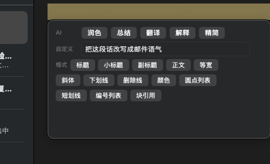
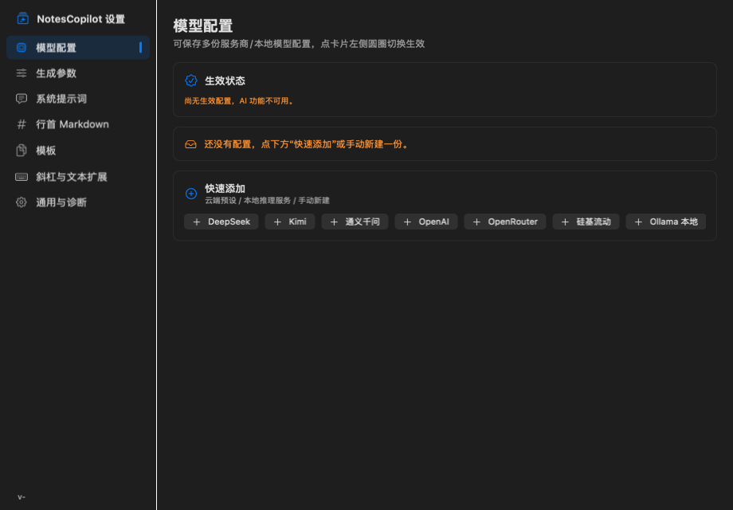

<div align="center">


# NotesCopilot

**macOS 原生菜单栏 AI 写作助手，深度集成 Apple Notes**

`Swift` · `AppKit/SwiftUI` · `零依赖` · `arm64` · `macOS 13+`

</div>

---

NotesCopilot 常驻菜单栏，为 Apple Notes 提供 AI 加工能力：全局快捷键呼出对话面板、Notes 内 `/` 唤起斜杠命令、选中文本即刻弹出加工条（AI 快捷指令 + 自定义指令 + Notes 原生格式按钮）。Notes 正文操作通过辅助功能（Accessibility）通道执行，并校验原笔记、光标和原文，减少误写。

> 设计参考 ProNotes 的逆向取证结论：AX 轮询通道、模板即笔记、NotesStore 直读等。

## ✨ 功能特性



### 1. 菜单栏 AI 面板（⇧⌘Space 全局呼出）
- 菜单栏常驻，任意应用内按 `⇧⌘Space` 呼出对话面板
- 流式输出，Markdown 预览／原文切换；支持代码块、表格、清单与富文本写回
- 已完成结果确认后写入 Notes；截断或失败保留部分输出，可重试／继续生成
- 可查看会话历史；切换笔记来源或模型配置自动开始新会话，连续对话最多携带最近 6 轮
- 无 Dock 图标（LSUIElement），不打断工作流

### 2. 斜杠命令（Notes 内输入 `/`）
- 在 Notes 中输入 `/` 自动唤起命令面板，按分组展示：
  **AI 加工**（润色/总结/翻译/解释/精简）· **Markdown 格式** · **模板** · **工具**
- 自动取光标前上下文，AI 回答不再"凭空瞎答"
- 默认将 Notes「Templates」文件夹中的笔记作为模板，无需导入；在 Notes 中修改、移出或删除后自动刷新
- Notes 模板与本地模板均支持日期、选区、输入询问和 AI 变量；同名时优先使用 Notes 版本，本地版本保留
- 输入 `/templates` 查看全部模板，`/ai`、`/markdown`、`/tools` 查看对应分类；分类后可加空格继续筛选，使用 `↑↓` 选择、`⏎` 执行

### 3. 选中即加工（悬浮加工条）
选中文本后自动弹出，三段式分组：

| 分组 | 内容 |
|---|---|
| **AI** | 润色 · 总结 · 翻译 · 解释 · 精简 |
| **自定义** | 输入任意指令，`⏎` 执行（如：改写成邮件语气） |
| **格式** | 标题 · 小标题 · 副标题 · 正文 · 等宽 · 斜体 · 下划线 · 删除线 · 颜色 · 圆点列表 · 短划线 · 编号列表 · 块引用 |

- 常用格式按钮 +「更多格式」，兼容中英文 Notes 菜单（AXPress 应用）
- 自定义指令执行后可「替换选区」或「追加到选区后」
- 面板保持展开，格式可连续叠加；生成可取消，写回失败保留结果与重试入口

### 4. URL 自动转标题超链
- 在 Notes 粘贴 URL + 空格，约 2 秒内自动替换为「网页标题」超链接
- 三级抓取兜底：HTTP 直抓 → 共享 Cookie → 浏览器标签页

### 5. 任意 OpenAI 兼容模型
- 内置预设：DeepSeek · Kimi · 通义千问 · OpenAI · OpenRouter · 硅基流动
- 本地模型自动探测：**Ollama** · **LM Studio** · llama.cpp · vLLM
- 多配置保存，点选切换，支持自定义端点



## 📦 安装

### 下载使用
1. 从 [GitHub Releases](https://github.com/m0nkee/notescopilot/releases/latest) 下载 `NotesCopilot-2.7.0-arm64.dmg`，打开后将 `NotesCopilot.app` 拖入「Applications」
2. 首次启动：系统设置 → 隐私与安全性 → **辅助功能** 中授权 NotesCopilot
3. 未配置模型时打开设置，已配置时打开 AI 面板；之后可用菜单栏图标或 `⇧⌘Space` 呼出

关闭窗口后，重新打开 `NotesCopilot.app` 会恢复设置或主面板。菜单栏图标被刘海或其他菜单遮挡时，也可从设置侧栏直接打开 AI 面板或笔记库，或使用 `⇧⌘Space`。

更新入口位于菜单栏的「检查更新…」、设置侧栏及「通用与诊断 → 版本更新」。默认每天自动检查一次正式发布版本，发现新版本时提醒；选择「稍后提醒」后至少间隔一天再次提醒。可在设置中关闭自动检查，仍可手动检查。点击下载会打开对应 GitHub 发布页，下载 DMG 后将应用拖入「Applications」替换旧版本。

当前发布包支持 Apple Silicon（arm64）、macOS 13 及以上，使用开发证书签名，尚未完成 Apple 公证；其他 Mac 上的 Gatekeeper 可能阻止启动。正式可信分发还需要 Developer ID Application 签名与 Apple 公证。

### 从源码构建
```bash
git clone https://github.com/m0nkee/notescopilot.git && cd notescopilot
./build.sh          # 产出 build/NotesCopilot.app
scripts/run-tests.sh  # 十套逻辑、异步与合成资料库回归
scripts/check-ui.sh   # 二十三种原生界面布局及分类键盘交互验证（使用隔离模拟数据）
scripts/check-startup.sh # 真实 AppDelegate 窗口生命周期回归（需图形会话，使用隔离模拟数据）
# 应用正在使用时，可构建到单独目录，稍后再切换
NC_BUILD_OUTPUT=build/pending/NotesCopilot.app ./build.sh
# 无交互验证可强制 adhoc，不触发开发证书私钥授权
NC_CODESIGN_IDENTITY=- NC_BUILD_OUTPUT=build/check/NotesCopilot.app ./build.sh
# 生成可分发 DMG（不会替换当前正在运行的应用）
NC_BUILD_OUTPUT=build/release/NotesCopilot.app ./build.sh
scripts/package-dmg.sh
```
> 零第三方依赖，仅需 Xcode 命令行工具（swiftc）。

构建优先使用有效的 `NotesCopilot Dev` 证书，或唯一的 Apple Development 身份；也可通过 `NC_CODESIGN_IDENTITY` 指定证书。没有可选身份时使用 adhoc，重建后可能需要重新授予系统权限。选定开发身份后的签名失败会明确中止，避免静默更换权限身份。

模型页顶部固定显示“保存配置”及保存状态，编辑仍会尝试自动保存。保存遇到钥匙串授权错误时，当前编辑内容会保留；点击“保存配置”或恢复卡的“授权钥匙串并保存”，由系统提示完成授权或取消。

## 🔐 权限说明

| 权限 | 用途 |
|---|---|
| 辅助功能（必需） | 读写 Notes 选区/光标、枚举格式菜单、AX 轮询通道、CGEvent 键击投递 |
| 自动化（Apple Events） | 读取当前笔记身份以安全绑定选区/写回目标，以及创建笔记等脚本操作 |
| 输入监控 | 当前键盘导航与关键词扩展使用已授权的辅助功能通道，无需额外开启 |
| 完全磁盘访问（资料库与 Notes 模板需要） | 只读本机 Notes 数据库、建立正文搜索索引与读取 Templates 文件夹 |

Notes 中输入 `/` 或选中文字没有反应时，先查看 AI 面板的笔记上下文提示，或设置 → 通用与诊断。辅助功能未授权会阻断触发；读取笔记身份被拒绝时，还需在自动化中允许 NotesCopilot 控制 Notes。两项权限分开检查，输入监控不影响鼠标点击斜杠命令。

笔记库索引和模板保存在本机；AI 请求将当前上下文、最近会话及附件直接发送到你配置的服务商。API Key 存储在系统钥匙串。URL 标题转换会访问对应网页，并尝试本机共享 Cookie 或已打开的浏览器标题。

## 🚀 快速上手

1. **配置模型**：菜单栏图标 → 设置 → 选择服务商或本地模型，填入 API Key
2. **对话**：任意应用按 `⇧⌘Space`，输入问题，结果可写入 Notes
3. **斜杠命令**：在 Notes 正文输入 `/`，选择命令
4. **选中加工**：选中一段文字 → 弹出加工条 → 点按钮或输入自定义指令

详细功能说明见 [docs/USAGE.md](docs/USAGE.md)。

## 🧱 项目结构

```
notescopilot/
├── build.sh              # 一键构建脚本（swiftc 直编，产出 .app）
├── Info.plist            # Bundle 配置（v2.7.0，LSUIElement）
├── assets/               # 应用图标 PNG、ICNS 与生成记录
├── src/                  # 源码（模块职责，见 docs/ARCHITECTURE.md）
├── tests/                # 十套回归（含写回、流式、资料库、产品逻辑和更新检查）
├── scripts/run-tests.sh  # 测试回归脚本
├── tools/                # 开发期调试工具（AX 探针、渲染工具）
└── docs/                 # 使用说明、架构文档、截图
```

## 🛠 开发

```bash
./build.sh              # 构建
scripts/run-tests.sh    # 单测回归
tail -f ~/Library/Logs/NotesCopilot-debug.log   # 查看诊断日志
```

调试与逆向取证工具位于 `tools/`（AX 探针、离屏渲染等）。

## 📄 License

[MIT](LICENSE)
