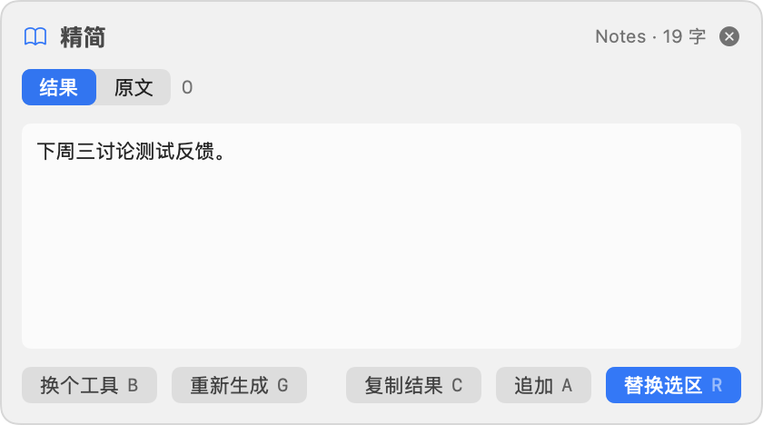

# 从 Apple Writing Tools 到 NotesCopilot 的选区交互

2026 年 11 月 22 日。产品范围是 NotesCopilot 支持的 Apple Silicon Mac。Apple 的交互依据来自 macOS 26、27 使用手册及 WWDC 的公开演示。兼容性实验使用 macOS 26.5.2。

**可以把选区 AI 做成 macOS 跨应用能力。** 自动浮钮默认仅用于 Notes。在「设置 → 斜杠与文本扩展 → 选区写作工具 → 应用范围」选择「全局」后，可读取的文字选区会显示浮钮。网页正文等只读选区可处理并复制，可编辑输入框还可替换和追加。手动从 macOS「服务」调用时，可以处理只读来源和复制结果。

## Apple 如何处理一次选区操作

| 用户所处的步骤 | Apple 的行为 | 对 NotesCopilot 的设计决定 |
|---|---|---|
| 选中文字 | Mac 上可从上下文菜单或「编辑」菜单调用。Notes 等原生视图还可在指针经过选区时显示入口。用户可以继续复制或调整选区 | Notes 连续两次检测到同一选区后显示小按钮。这时仅读取控件、范围及位置，点击才取笔记快照 |
| 决定要做什么 | 「描述修改」支持开放指令。校对针对错误，改写有友好、专业、简洁等语气。摘要、要点、列表、表格属于不同输出形式 | 弹出工具后同时展示选区摘录、自定义指令和编辑／阅读动作。Notes 原生格式收在一个菜单内 |
| 审阅修改 | 原生完整体验可在正文中显示改写。校对支持逐项查看修改，改写可以重新生成、对照原文或还原。会话中的编辑实际进入宿主文本存储和撤销栈 | 在独立面板保存原文和候选稿。用户可切换查看、重新生成或换工具。校对交付一份完整候选稿 |
| 采用结果 | 只读网页、PDF 文本的结果可在面板中复制。宿主可编辑时，摘要等结果才可替换原文 | 各入口都可复制。Notes 和能核对原选区的可编辑输入框都支持「替换选区」和「追加」。查看原文时复制的就是原文 |

前两步见 [Apple 的 Mac 使用手册](https://support.apple.com/zh-hans/guide/mac-help/mchldcd6c260/27/mac/27) 和 [WWDC24 的入口演示](https://developer.apple.com/videos/play/wwdc2024/10168/?time=78)。审阅与采用结果见 [macOS Tahoe 的校对、改写与只读操作说明](https://support.apple.com/en-au/guide/mac-help/mchldcd6c260/26/mac/26) 和 [WWDC24 的文本存储与撤销说明](https://developer.apple.com/videos/play/wwdc2024/10168/?time=403)。

Apple 的系统工具可能扩展到完整句子，并利用周围文本理解语境。富文本宿主还能参与处理样式、链接、附件和可忽略范围。NotesCopilot 对选区任务使用当前配置的模型，发送指令和所选文字。Notes 完整正文只在本机参与身份和写回校验。结果中的富文本由现有 Markdown 写回通道生成，原文中链接和样式的逐段对应关系并无保证。[Apple 对上下文和富文本的说明](https://developer.apple.com/videos/play/wwdc2024/10168/?time=260)

## 项目中实际改了什么

选区稳定后只显示一个原生按钮。单击或按 `M` 展开工具，然后选动作、对照原文，再决定复制或写回。启动翻译时面板保留尺寸和摘录，聊天正文重新公布选区时，生成中的请求和结果仍保留在面板里。系统服务本身已表达打开工具的意图，会直接进入动作选择。

工具页在动作旁标出字母。按 `T` 会把中文译成英文，其他语言译成简体中文。应用先用 macOS 识别原文语言。混排文字难以判定时，模型在同一次翻译里按整句语法选择方向。按 `I` 可指定其他目标语言。结果页中，`O` 切换原文与结果，`C` 复制当前版本。自定义指令获得焦点后，文字和输入法按键交给系统编辑器。[完整快捷键表](USAGE.md#入口三选区写作工具)

「Copilot 写作阅读助手」浮钮使用实色底、描边和系统文字颜色。即使页面与系统外观一明一暗，也能辨认名称和 `M` 提示。开启 macOS「增强对比度」后，描边进一步加粗。审阅面板使用系统材质和分段控件。关闭后，保留在原页面的选区会等到下一次鼠标或键盘操作再触发浮钮。[Apple 的 macOS 设计指南](https://developer.apple.com/design/human-interface-guidelines/designing-for-macos) · [Apple 的按钮设计指南](https://developer.apple.com/design/human-interface-guidelines/buttons)

以「下周三，我们会就测试反馈进行一次讨论。」为例，点「精简」后可在结果页对照「下周三讨论测试反馈。」。在 Notes 点击「替换选区」才会改正文。在只读材料上可以直接「复制结果」。这两个入口使用同一组动作和同一个请求生命周期。



| 情况 | 用户可见的行为 |
|---|---|
| 打开后又关闭，或刚发起第二次服务调用 | 旧请求失效，即使两次文字相同，迟到的结果也不能覆盖新会话 |
| 重新生成失败或模型返回空白 | 显示错误并保留上一份成功稿，可复制或重试 |
| 在审阅期间切换笔记、修改正文或移动选区 | 检测到变化后保留结果供复制。点击写回时还会再次核对笔记 ID、正文、AX 控件和 UTF-16 范围 |
| 需要格式化原笔记 | 展开「Notes 格式」，调用 Notes 本身的格式命令。系统服务会话只有文本，不提供笔记格式操作 |

## 浮钮与系统服务分别如何取得选区

| 路径 | 谁提供上下文 | 适用范围与取舍 |
|---|---|---|
| AppKit Writing Tools / `NSWritingToolsCoordinator` | 宿主把自己的视图、文本范围、几何信息及编辑回调交给系统 | 适合给自己开发的编辑器接入 Apple 的原生体验。所查公开接口面向宿主视图，未见向其他应用的 Apple Writing Tools 菜单注册任意第三方动作的入口 |
| macOS `NSServices` | 用户选择服务，宿主向服务粘贴板写入当前选区 | 已实现。只接收纯文本，在内存中开启审阅会话。宿主无需等待模型响应。可从应用菜单「服务」调用，部分应用也会放进右键菜单 |
| 辅助功能 AX | 从前台应用取得其公开的焦点控件、选区及文本属性 | 自动浮钮使用这条路径。Notes 有独立的笔记身份校验。其他可编辑输入框记录原进程、窗口、控件、范围、原文及可用的文档标识，确认时复核，再检查实际结果 |

WWDC24 演示中，使用 TextKit 2 的原生文本视图可承载完整行内体验，TextKit 1 显示面板。WKWebView 默认采用受限体验，宿主可以调整配置。WWDC25 进一步展示了自定义编辑器如何把范围、位置和内容更新交给协调器。这些能力依赖编辑器本身的配合。[WWDC24 的文本视图说明](https://developer.apple.com/videos/play/wwdc2024/10168/) · [AppKit Writing Tools](https://developer.apple.com/documentation/appkit/writing-tools) · [WWDC25 自定义编辑器演示](https://developer.apple.com/videos/play/wwdc2025/265/)

系统服务也能声明返回类型，由支持接收结果的宿主读回。提供者回调接收粘贴板、用户数据和错误指针，接口没有可长期持有的原文档范围。需要同步返回结果的服务默认等待 30 秒。本项目的模型请求允许等待 120 秒，随后还要给用户留出审阅时间。因此本次选择只声明输入类型，用户看完再复制。项目继续支持 Apple Silicon 上的 macOS 13 及以上，生成使用项目现有的模型配置，可以在 Apple 智能关闭时使用。[Apple 的服务回调](https://developer.apple.com/library/archive/documentation/Cocoa/Conceptual/SysServices/Articles/providing.html) · [服务输入、返回及超时](https://developer.apple.com/library/archive/documentation/Cocoa/Conceptual/SysServices/Articles/properties.html)

全局模式只检查前台应用。可读选区稳定后显示浮钮并在内存中暂存选中文字，宿主提供选区坐标时贴近选区摆放，无法取坐标时使用鼠标位置。鼠标移向浮钮期间，宿主重绘导致的空选区不会收起浮钮。展开时才读取可编辑字段全文用于本地校验。原选区已消失时仍可用暂存的摘录翻译或总结，结果可以复制。用户点动作时，只把选中文字和指令交给模型。系统服务由菜单或快捷键触发，适用于其他能导出文字的控件。

## 跨应用覆盖到哪里

| 来源 | 如何使用当前版本 | 如何判断覆盖 |
|---|---|---|
| Apple Notes 正文 | 选区旁的 Copilot 按钮可预览、替换、追加、复制和使用原生格式 | 小按钮需要辅助功能，绑定笔记身份需要 Notes 自动化权限。通过「服务」打开时走纯文本路径 |
| 标准 AppKit 文本框 | 全局模式下，选区旁会出现写作工具。可编辑文字支持替换、追加，只读文字支持复制结果 | 在独立进程的 `NSTextField` 和 `NSTextView` 中实测自动浮钮、预览和原地替换。用含 emoji 和重复短语的文本确认了替换落点 |
| 网页输入框 | 全局模式可在支持的输入框中划选、审阅、原地替换或追加 | 在独立应用的 WKWebView 中验证了 HTML 单行 `input` 和多行 `textarea`。页面自身收到一次输入事件，字段内容与预期逐字一致，浏览器撤销可恢复原文 |
| Chrome 地址栏 | 在地址栏里选中部分文字，自动显示工具。审阅后可替换或追加，保留后面的文字 | 在独立浏览器配置中验证了真实地址栏及两种写入后的值 |
| Codex 聊天输入框 | 在「Work with Codex」输入框划选，自动显示工具 | 在本机 Codex 的实际聊天窗口验证了浮钮、菜单和捕获的选中文字 |
| 本地 OpenMausBot 消息框 | 在「Message MausBot」选中文字，审阅后可替换或追加 | 在已安装的 OpenMausBot 中使用独立本地数据目录，核对了消息框内的最终文本。测试消息未发送 |
| OpenMausBot 和 WorkBuddy 只读正文 | 选中文字，单击浮钮或按 `M` 打开工具，再点「翻译」 | 在 OpenMausBot 的合成聊天回复和 WorkBuddy 主窗口的页面文字上实测，进度面板保留至译文出现，结果页提供复制操作 |
| 网页阅读和带文本层的 PDF | 公开可读选区时自动显示工具并可复制，提供文本服务的视图也可手动调用 | 用本地 HTML 验证了 WKWebView 的服务选区，用合成文稿验证了 PDFKit 文本层 |
| 安全输入框 | 自动浮钮跳过密码框 | 在原生 `NSSecureTextField` 上验证了无浮钮；该控件也没有提供文本服务请求者 |
| Safari、Mail、预览、Electron 应用及自绘编辑器 | 在具体视图中选取文字，检查该应用的「服务」菜单 | 同一应用可混用多种控件。上述控件实验不能证明某个应用所有界面均可用。只有像素的扫描页还需要宿主提供文字识别或文本层 |

本机实验发现，标准 `NSTextView` 在服务请求者协商中接受 `NSStringPboardType`。只传 `public.utf8-plain-text` 时，测试控件拒绝导出选区。采用旧类型导出后，提供方可以用现代 `.string` 读回相同文字。因此产品同时声明这两个文本类型。这个结果说明了为何仅检查 plist 或模拟字符串不能代替宿主测试。[Apple 的自定义视图协商说明](https://developer.apple.com/documentation/appkit/supporting-writing-tools-via-the-pasteboard)

本机 WebKit 实验还发现，可编辑网页表单接受 `AXSelectedText` 写入调用后，页面内容可能保持原样；只读字段也可能报告该属性可写。显示写回按钮前会另行检查字段的可编辑能力。对于网页输入，确认替换时调用原应用的标准粘贴命令，随后读取字段核验结果。此路径短暂使用系统剪贴板，若用户在此期间复制了其他内容，则保留用户的新内容。

将新版应用放入「应用程序」并打开一次，常规启动会请求系统刷新服务列表。服务名为「用 NotesCopilot 处理选中文本」。可在「系统设置 → 键盘 → 键盘快捷键 → 服务」启用或分配快捷键。现有 ⇧⌘Space 继续用于对话面板。自动浮钮和手动服务可分别控制。[Apple 的服务使用指南](https://support.apple.com/en-mt/guide/mac-help/mchlp1012/mac)

Chrome 和 Electron 可能在启动时只公开窗口。全局模式会向前台宿主请求完整的辅助功能树，并为尚未就绪的渲染进程重试。只读网页通过文本范围或浏览器的文本标记读取选区，段落间的空白取决于宿主提供的纯文本。[Chromium 的 macOS 实现](https://github.com/chromium/chromium/blob/main/chrome/browser/chrome_browser_application_mac.mm) 和 [Electron 辅助功能接口](https://www.electronjs.org/docs/latest/tutorial/accessibility)

跨应用写回由控件实际公开的能力决定。写回前重新核对焦点、内容及 UTF-16 范围，任一项变化都会保留生成稿供复制。对于自绘编辑器、具有多处选区的编辑器，以及在同一窗口复用控件的应用，按具体控件验收。只读网页与 PDF 摘要可通过系统服务完成。[Apple 的 AX 能力与属性可写性接口](https://developer.apple.com/documentation/applicationservices/axuielement_h)

## 如何复核

- **全局选区。** 在拥有辅助功能权限的 macOS 图形会话运行 `NC_TEST_INPUT_FIELDS=1 scripts/check-startup.sh`。它启动一个独立的合成输入应用，通过正常轮询和写回路径，验证仅 Notes 默认值、全局浮钮、选区替换、移动选区、切换字段、改动周边文字及切回仅 Notes。
- **系统派发。** 在 macOS 图形会话运行 `NC_TEST_SYSTEM_SERVICE=1 scripts/check-startup.sh`。脚本临时注册独立名称的测试应用、刷新服务缓存，由另一进程的原生文本框调用 `NSPerformService`。本机收到的文字与选区逐字一致，前后两段没有进入面板。测试结束注销该测试应用。
- **审阅与写回。** 同一组测试使用确定性的模型响应、模拟 Notes 快照和单独命名的粘贴板，验证查看原文、复制当前版本、拒绝过期写回及服务会话隔离。`scripts/run-tests.sh` 覆盖请求取消和 Notes 写回通道。已安装应用另外在 OpenMausBot、WorkBuddy 和 Chrome 中执行了真实翻译，结果见[发布验收记录](VALIDATION.md)。
- **宿主控件。** 在项目根目录编译并运行下方探针。它在独立窗口中创建临时网页、PDF 和安全文本框，只输出控件是否提供服务及导出的字符串是否匹配。结论限于被测控件和系统版本。

```bash
mkdir -p build
swiftc -parse-as-library tools/probe_selection_hosts.swift -o build/probe-selection-hosts
build/probe-selection-hosts
```
